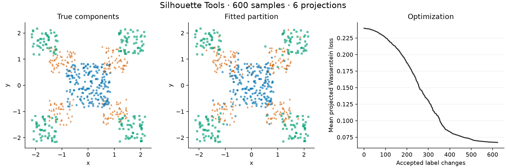

# Silhouette Tools

Python tools for **silhouette mixture estimation (SME)**: fit
mixture-of-products models by matching one-dimensional projected distributions
using Wasserstein distance.

This is the research implementation accompanying Robert A. Vandermeulen's
[The Silhouette Operator: Identifiability of Low-Rank Measures from
One-Dimensional Projections](https://arxiv.org/abs/2610.09687). The library
includes pairwise projections, cached objectives, partition optimization, and
mixture-of-products density models. It is an early version; the API may change.

## Quick start

Use Python 3.10 or later. From the outer `silhouette-tools` project folder:

```sh
python3 -m venv .venv
source .venv/bin/activate
python -m pip install -e ".[examples]"
python examples/three_components.py --show
```

The activation command is for macOS and Linux. On Windows, use
`.venv\Scripts\Activate.ps1` in PowerShell. The editable install keeps the
installed library linked to the code in this folder. To install the library
without the plotting dependency, use `python -m pip install -e .`.

The [two-dimensional example](examples/README.md) generates three overlapping
components, fits a partition, and plots the result and loss. It needs no
downloaded data or saved experiment results. The figure is also saved to
`examples/output/three_components.png`; omit `--show` to save it without opening
a plot window.



## Using the library

The distribution name is `silhouette-tools`; Python imports use
`silhouette_tools`:

```python
from silhouette_tools.metrics.wasserstein import wasserstein_1d

distance = wasserstein_1d([0, 1], [1, 2])
print(distance)  # 1.0
```

See [the example script](examples/three_components.py) for a complete fit using
the projection, objective, and optimizer interfaces.

## Repository contents

```text
silhouette-tools/           Project / Git repository
    silhouette_tools/       Importable Python library
    examples/               Self-contained example, instructions, and preview
    tests/                  Library tests
    experiments/            HEPMASS and kin8nm paper experiments
    paper_results/          Final result archives, original splits, and CSV tables
    docs/                   Development notes and Git guide
    CITATION.cff            Preferred research citation
    LICENSE                 BSD 3-Clause software license
    pyproject.toml          Installation and test configuration
```

The retained paper experiments and data requirements are described in
[experiments/README.md](experiments/README.md). Identifiable final results,
original splits, and readable comparison tables are in
[paper_results/README.md](paper_results/README.md). Obsolete experiments,
exploratory runs, and benchmarks have been removed. Newly generated experiment
data, results, plots, caches, and virtual environments are excluded from Git.
Only the `silhouette_tools` library is installed as a Python package.

## Development

With your virtual environment activated:

```sh
python -m pip install -e ".[test,examples]"
python -m pytest
```

The library depends on NumPy, SciPy, scikit-learn, and statsmodels. Optional
extras add pytest (`test`) and Matplotlib (`examples`). The optional POT package
is needed only for `wasserstein_1d_assume_sorted`.

The optimizer's `best_score` and `best_labels` fields have a known bookkeeping
issue in some modes. Use `score` and `labels` for the current result, as the
example does. See [development notes](docs/development-notes.md) for details
and the earlier cleanup record. Existing scripts using the former
`partitioned_densities` import should switch to `silhouette_tools`.

For the first commit and upload, see the [Git guide](docs/git-guide.md).

## Citation

If Silhouette Tools contributes to your research, please cite the accompanying
paper:

```bibtex
@misc{vandermeulen2026silhouette,
  title = {The Silhouette Operator: Identifiability of Low-Rank Measures from One-Dimensional Projections},
  author = {Robert A. Vandermeulen},
  year = {2026},
  eprint = {2610.09687},
  archivePrefix = {arXiv},
  primaryClass = {math.ST},
  url = {https://arxiv.org/abs/2610.09687}
}
```

[CITATION.cff](CITATION.cff) supplies the same preferred citation for GitHub.

## License

The software, examples, and accompanying software documentation are licensed
under the [BSD 3-Clause License](LICENSE). Copyright and license notices must be
preserved in redistributions. The citation request above is separate from those
license conditions.

The accompanying paper is excluded from the software license; see its
arXiv record for publication terms.
